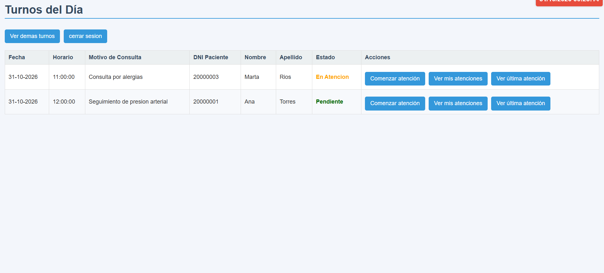
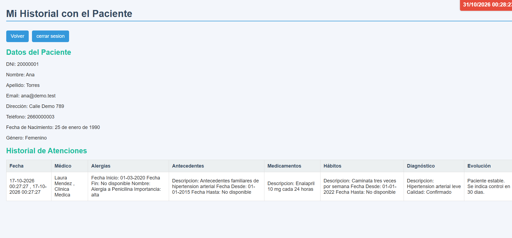
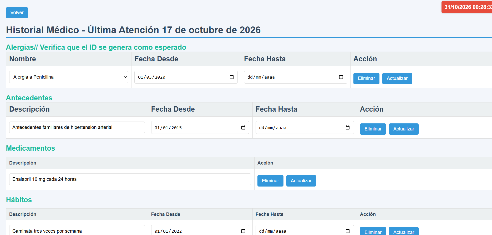

# AgendaMedica

Sistema web de gestión de turnos médicos y pacientes, con historia clínica por atención. Desarrollado con Node.js, Express y MySQL.

## Capturas

<table>
  <tr>
    <td><br><sub>Inicio de sesión</sub></td>
    <td><br><sub>Agenda del día</sub></td>
  </tr>
  <tr>
    <td><br><sub>Gestión de turnos</sub></td>
    <td><br><sub>Historial del paciente</sub></td>
  </tr>
</table>

## Funcionalidades

- Inicio de sesión con sesiones de usuario y contraseñas cifradas con bcrypt.
- Agenda de médicos y gestión de turnos (del día, pasados y futuros).
- Alta y administración de pacientes y médicos.
- Historia clínica: alergias, antecedentes, hábitos, medicamentos, diagnósticos y evoluciones.
- Historial completo del paciente y última atención.

## Tecnologías

- **Backend:** Node.js, Express, express-session, bcrypt
- **Vistas:** Pug, CSS
- **Base de datos:** MySQL (mysql2)
- **Configuración:** variables de entorno con dotenv

## Instalación

1. Cloná el repositorio y entrá a la carpeta del proyecto:
   ```bash
   git clone https://github.com/RamonAlcaraz1987/AgendaMedica.git
   cd "AgendaMedica/Turnos Medicos"
   ```
2. Instalá las dependencias:
   ```bash
   npm install
   ```
3. Creá tu archivo de configuración a partir del ejemplo y completá tus valores:
   ```bash
   copy .env.example .env
   ```
4. Creá la base de datos `am` e importá la estructura y los datos de ejemplo:
   ```bash
   mysql -u root < database/schema.sql
   mysql -u root am < database/seed.sql
   ```
5. Iniciá el servidor:
   ```bash
   node index.js
   ```
6. Abrí http://localhost:3000

## Usuario de prueba

- Usuario: `demo`
- Contraseña: `demo1234`

Todos los datos de ejemplo son ficticios.

## Estructura

```
Turnos Medicos/
├── config/        conexión a la base de datos
├── controllers/   lógica de cada módulo
├── entidades/     modelos
├── routes/        rutas de la aplicación
├── views/         vistas Pug
├── public/        estilos e imágenes
└── database/      schema.sql y seed.sql
```

## Autor

Ramon Alcaraz — [LinkedIn](https://linkedin.com/in/ramon-alcaraz-arg) · [GitHub](https://github.com/RamonAlcaraz1987)